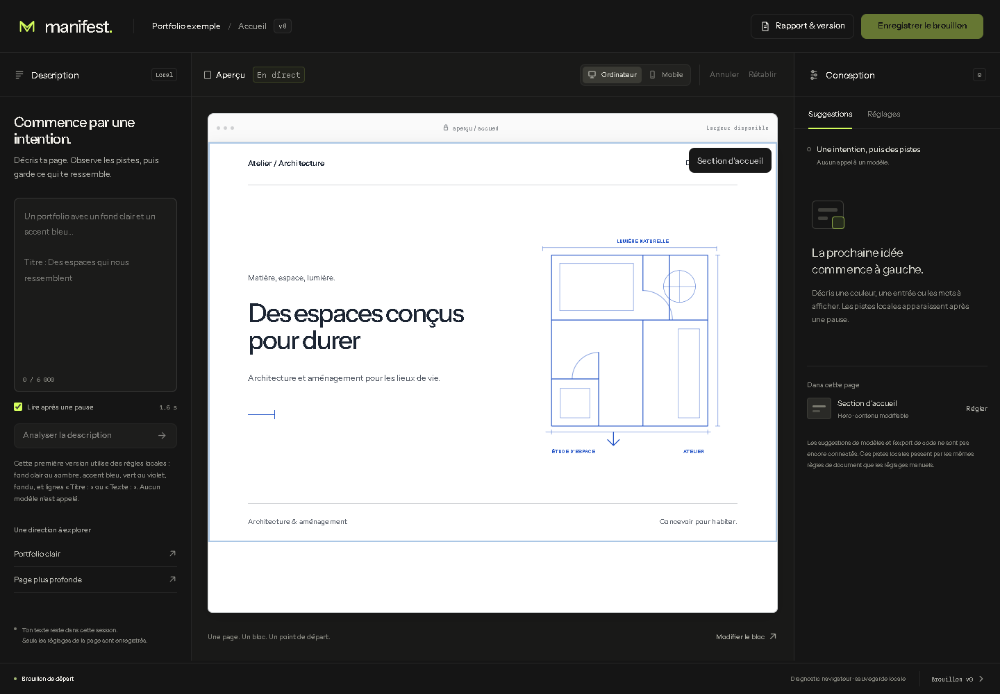
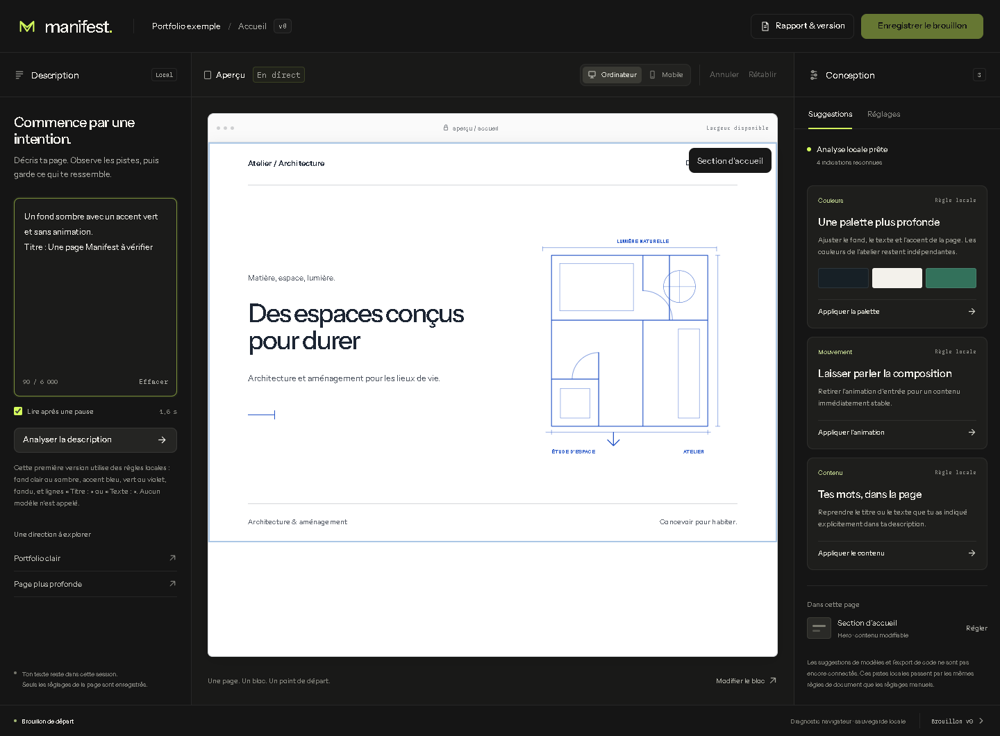
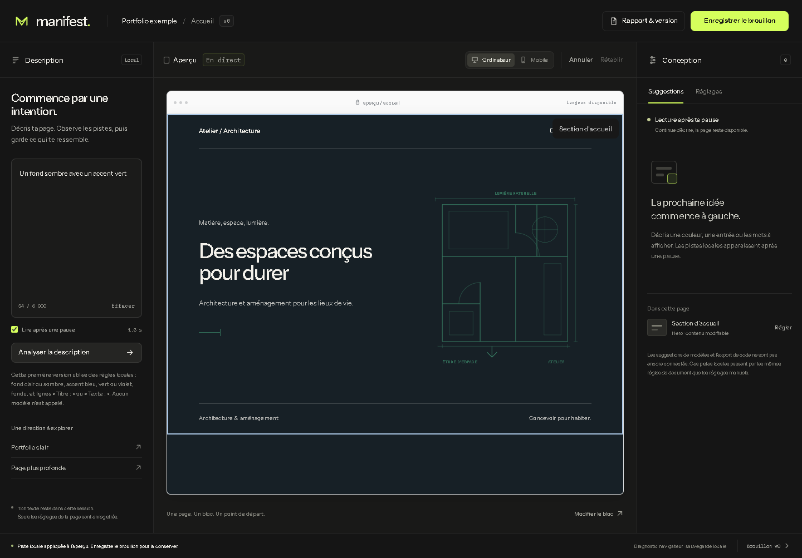
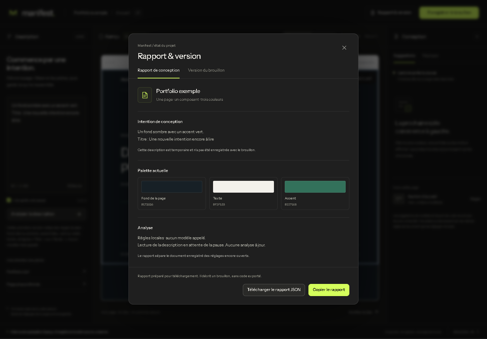
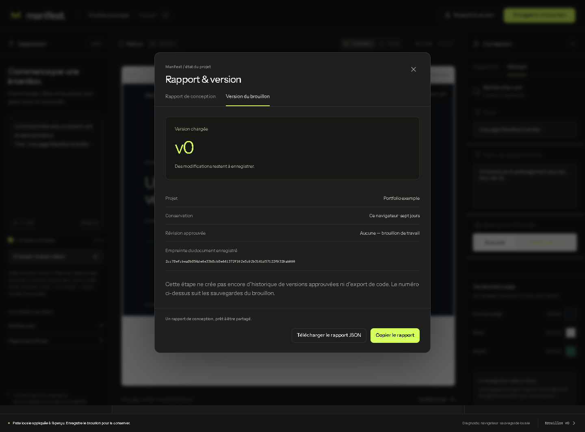
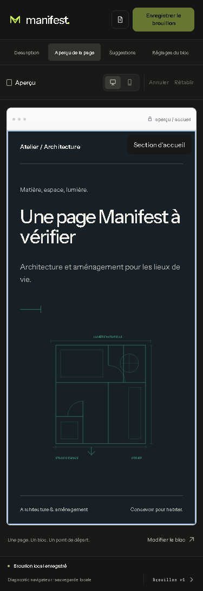
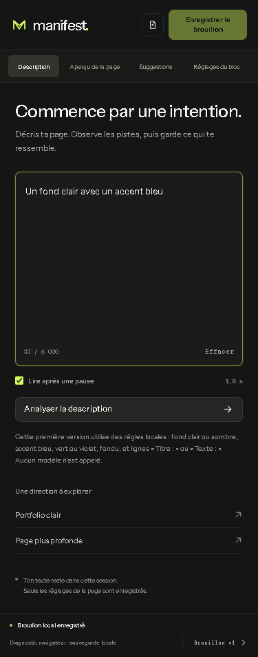
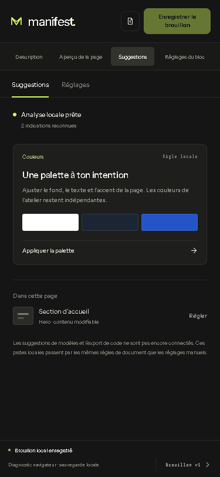

# Manifest — vérification indépendante de l'interface

Date : 2 novembre 2026. Agent : `arc01_qa`. Branche : `work/arc-01-qualification`, arbre de travail avant intégration. Vérification de l'interface et des parcours locaux ; aucun code applicatif ni fichier de test modifié par cette revue.

## Verdict

**Parcours locaux examinés réussis après trois corrections.** La coque sombre, la description à gauche, l'aperçu central dominant, les pistes à droite et le rapport de brouillon sont présents et utilisables sur les dimensions testées. Les suggestions sont explicitement des règles locales ; aucune inférence de modèle, révision approuvée ou génération de code n'est présentée comme disponible.

Cette conclusion porte sur les critères structurels communiqués, pas sur une reproduction exacte de Figma. Les identifiants de nœuds transmis étaient `3-3488`, `3-3655` et `3-3983` ; aucun fichier Figma, image source ou file key exploitable n'a été fourni à cet agent. Aucune comparaison pixel par pixel n'est donc revendiquée.

## Exécutions et preuves

| Vérification exécutée par QA | Résultat |
|---|---|
| `npm test` | 20 réussis, 1 ignoré sur Windows pour création de lien symbolique ; aucun échec |
| `npm run check` | registre de 26 tickets valide, révision 3 |
| `node --import tsx --test apps/editor-web/test/manifest-analysis.test.ts` | 7 tests réussis sur le module local, y compris invalidation d'une ancienne intention |
| Parcours Chrome local à 1440 × 1000 et 375 × 812 | 18 contrôles observés réussis, résultats dans [smoke-results.json](smoke-results.json) |
| Recontrôle après corrections et saisie | 8 contrôles ciblés réussis, résultats dans [targeted-results.json](targeted-results.json) |

Les parcours navigateur ont utilisé Chrome installé, Playwright 1.64.1 et un serveur Vite local dédié sur le port 4174. Les captures ont été sauvegardées puis ouvertes et inspectées ; elles montrent les états réellement atteints. Le test de pause a observé l'arrivée de la piste à 1 877 ms après l'action de saisie, pour un délai configuré de 1 500 ms ; ce temps inclut le navigateur et l'automatisation et n'est pas une promesse de latence.

Les 18 contrôles initiaux et les 8 recontrôles sont des scénarios de revue indépendants exécutés pendant cette session. Ils ne constituent pas encore une suite de tests Manifest enregistrée dans la CI. La suite E2E historique ARC-01 a été adaptée par un autre intervenant ; son résultat final d'intégration doit être rapporté séparément par l'orchestrateur.

## Parcours observés

1. **Ouverture — bon état.** Coque mesurée à `rgb(21,21,21)`, site initial blanc, colonnes de 276 / 868 / 296 px à une largeur de 1 440 px. L'aperçu possède la plus grande surface et les données du site restent distinctes du thème de l'éditeur.

   

2. **Description et pistes — bon état.** La description éditable produit des pistes après la pause. La palette n'est pas appliquée avant un choix explicite. Le caractère local, les indications reconnues et l'absence d'appel à un modèle sont visibles.

   

3. **Application — bon état après correction.** Appliquer la palette modifie le site sans changer la coque ; appliquer le contenu modifie le Hero. Les réglages Puck restent accessibles dans leur onglet. Le cadre suit maintenant le fond du site sur toute sa hauteur.

   

4. **Rapport — bon état après correction.** Le dialogue reçoit le focus initial sur son bouton de fermeture. Le rapport indique désormais si l'analyse est en attente : le JSON exporté a `status: "typing"`, `upToDate: false` et `recognized: null`, au lieu d'un faux résultat de zéro indication. Le rapport sépare document enregistré, copie de travail et description temporaire.

   

5. **Version et téléchargement — bon état pour un brouillon.** L'onglet montre la version chargée, la portée de conservation et l'absence de révision approuvée. Le JSON téléchargé identifie les modifications non enregistrées et annonce `approvedRevision`, `codeExport` et `modelInference` à `false`. La sauvegarde puis le rechargement retrouvent les réglages appliqués ; la description temporaire n'est pas persistée.

   

6. **Aperçu mobile — bon état.** À 375 px, le document n'a pas de défilement horizontal global (`scrollWidth = innerWidth = 375`). La page conserve son thème et ses réglages enregistrés.

   

7. **Description mobile — bon état.** Le changement de panneau expose le champ de description ; la saisie au clavier conserve son focus. Le panneau reste dans la largeur du viewport.

   

8. **Suggestions mobile et gardes de saisie — bon état.** Les pistes sont accessibles dans le panneau nommé, sans débordement horizontal. Une nouvelle intention invalide immédiatement les anciennes pistes ; aucune analyse ne se produit pendant la composition IME. La lecture reprend après la fin de composition et la pause. La suspension empêche les pistes automatiques et l'action manuelle reste fonctionnelle.

   

Aucune erreur JavaScript non gérée et aucune requête hors du serveur local n'ont été observées pendant le parcours initial. Ce constat ne démontre pas tous les chemins réseau possibles du produit futur.

## Défauts trouvés puis levés

| Constat initial | Correction par le frontend | Recontrôle indépendant |
|---|---|---|
| Le fond sombre ne remplissait que le Hero ; une bande blanche restait en bas de l'aperçu | le fond du cadre suit `color.background` | Hero et cadre mesurés tous deux à `rgb(23,32,38)` ; capture 09 inspectée |
| Le rapport ouvert avant la fin de la pause montrait zéro indication reconnue alors que l'analyse était seulement périmée/en attente | phase et fraîcheur explicites dans l'interface et le JSON | `status=typing`, `upToDate=false`, `recognized=null` vérifiés ; capture 10 inspectée |
| Mention de description temporaire à 10 px, contraste mesuré de 4,43:1 sur le fond du rapport | usage du token secondaire plus clair | contraste recalculé à 6,74:1 pour `rgb(166,166,160)` sur `rgb(31,31,31)` |

Les captures 03 et 04 conservent les états avant correction, pour traçabilité : [ancien fond partiel](screenshots/03-desktop-applied.png), [ancien rapport transitoire](screenshots/04-desktop-report.png). Elles ne représentent pas le verdict final.

## Dettes et risques à transmettre à la réunion

- **Maintenance CSS — propriétaire recommandé : frontend.** La nouvelle coque utilise `manifest.css` après la feuille historique `style.css`, avec plusieurs sélecteurs communs. Ce choix permet l'incrément, mais rend le rendu dépendant de l'ordre de cascade. Consolider les propriétaires de styles et les tokens avant l'élargissement des primitives UI ; garder les captures et parcours comme critères de non-régression. Ce n'est pas un défaut fonctionnel bloquant observé.
- **Couverture de régression Manifest — propriétaire recommandé : QA.** Inscrire les parcours de description/pause/IME, application explicite et rapport dans la suite E2E maintenue. Les contrôles de cette revue les ont exécutés réellement, mais une modification ultérieure pourrait les casser sans être couverte par les seuls tests purs du module.
- **Référence visuelle — propriétaire recommandé : produit/design.** Conserver l'export des frames Figma et leurs dimensions pour une prochaine comparaison de fidélité. Le présent avis ne peut pas valider des écarts à une source non accessible.
- **Confort et accessibilité — à compléter.** Plusieurs métadonnées et mentions restent petites, notamment sur mobile. Le contrôle ciblé de contraste ci-dessus est passé après correction ; le zoom complet, le lecteur d'écran et l'appareil mobile physique n'ont pas été testés. Aucune conformité WCAG globale n'est annoncée.

Les API de modèles, les révisions approuvées, la persistance de production, OAuth et l'export de code sont des capacités du backlog explicitement absentes de ce prototype. Leur absence n'est pas transformée artificiellement en dette de cette interface. La qualification du vrai hôte ChatGPT reste indépendante de cette revue locale.
