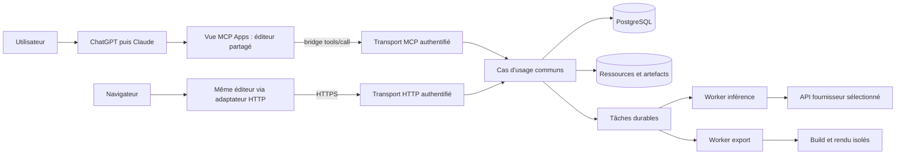

# Architecture de référence

## Décisions structurantes

Un monolithe modulaire TypeScript expose les transports HTTP et MCP au-dessus des mêmes cas d'usage. Un worker séparé exécute inférence et exports ; l'exécution de code de build dispose d'une frontière d'isolation supplémentaire. PostgreSQL conserve les états et tâches durables. Le stockage objet conserve les ressources et artefacts immuables. Aucun service payant ni hébergeur précis n'est imposé avant ARC-02.

Le frontend est React/TypeScript et utilise Puck de façon contrôlée. Ses slots récursifs portent les blocs imbriqués ; ne pas introduire un deuxième arbre de composition avec des identifiants concurrents. Les types de composants, propriétés et slots viennent du catalogue versionné. Les schémas de ce dossier valident l'enveloppe ; les schémas de chaque composant ferment les propriétés autorisées.

## Vue système



Le poste et les hôtes n'accèdent jamais aux clés des fournisseurs. Le modèle ne dispose pas d'un accès direct à la base, au réseau interne ou au système de fichiers : il produit des propositions structurées que le domaine valide.

L'éditeur est une seule surface React à trois zones persistantes, sans navigation entre étapes ni écran séparé de réglage de bloc. `IntentComposer` transmet le brief du créateur après le debounce au fournisseur explicitement sélectionné ; `CatalogSearch` interroge les releases locales/admises sans déclencher l'IA. Une carte catalogue connaît son `catalogItemId`, son `releaseId/hash`, son origine/licence, ses slots et capacités. Son aperçu au survol n'écrit pas dans le document ; « Ajouter » ou le glisser-déposer produit une opération canonique sur le Snapshot et une référence structurée visible sous le champ principal. Cette pièce jointe rejoint le contexte des prochaines propositions et le rapport sans muter le texte libre. Aucun code de référence ou composant ne peut être ajouté sans provenance.

## Modules et propriétaires

| Module proposé | Propriétaire fonctionnel | Entrées/sorties | Interdit |
|---|---|---|---|
| packages/domain | Tech lead | Snapshot, opérations, résultat déterministe | Réseau, React, SDK fournisseur |
| packages/catalog | Catalogue/design | Config Puck, schémas, rendus et manifests | Appel IA, secrets |
| packages/editor | Frontend | Document confirmé + projection de proposition | Écriture directe en DB |
| packages/host-adapters | Frontend/MCP | Interface transport commune | Logique métier dupliquée |
| services/api | Backend | HTTP/MCP -> cas d'usage | Exécuter du code généré |
| packages/inference | Backend IA | Contexte borné -> propositions vérifiées | Mutation silencieuse du brouillon |
| packages/exporter-react | Export | Snapshot approuvé -> fichiers | Redessiner librement la page |
| services/worker | Export/infra | Jobs -> états/artefacts | Secrets dans l'environnement de build |
| packages/contracts | Tech lead | Types/schémas/messages communs | Schémas divergents par équipe |

Arborescence proposée pour le futur dépôt :

```text
apps/editor-web/             # démarrage navigateur
apps/mcp-view/               # bundle HTML MCP Apps
services/api/                # HTTP, MCP, auth et cas d'usage
services/worker/             # inférence et orchestration des builds
packages/domain/
packages/contracts/
packages/catalog/
packages/editor/
packages/host-adapters/
packages/inference/
packages/exporter-react/
tests/fixtures/, contract/, e2e/, visual/, security/
docs/adr/, runbooks/
```

Ce dossier ne crée pas cette application ; il décrit l'organisation à mettre en place au ticket ARC-03.

## Intégration MCP Apps

Le serveur expose une ressource `ui://design/editor.html`, MIME `text/html;profile=mcp-app`. Seul `open_designer` porte `_meta.ui.resourceUri` ; les opérations de données ne remontent pas un nouvel éditeur à chaque appel.

Ordre correct : **Vue -> Hôte `ui/initialize`**, réponse de capacités/contexte, puis Vue -> Hôte `ui/notifications/initialized`. L'hôte livre les entrées et résultats par les notifications correspondantes. Employer le SDK MCP Apps compatible et enregistrer les handlers avant connexion ; ne pas réécrire le protocole par mémoire.

Le bridge `tools/call` appelle les opérations de lecture, sauvegarde, génération et export. Les outils de poll et de mutation réservés à la vue utilisent la visibilité app lorsque prise en charge. Le résumé envoyé au modèle hôte reste compact ; le document complet et les événements techniques restent dans les données réservées à la vue. Les attributs de visibilité et annotations ne remplacent jamais l'autorisation serveur.

Le bootstrap consomme uniquement le contexte documenté reçu pendant `ui/initialize` ou les arguments explicites de l'outil. `LaunchContext` porte `operation` (`create_project`, `create_page`, `modify_page`), la cible et sa version de base quand elles existent, `assistantProposal` (texte de la proposition de l'assistant) et éventuellement `initialCandidate` (Snapshot candidat ou opérations structurées, avec cible et `baseDraftVersion`). `create_project` ne fournit pas d'identifiant de projet et part d'une base vide ; `create_page` exige un projet existant, sans page cible, et charge son Snapshot ; `modify_page` exige le projet, la page et la version de brouillon attendue. Une proposition structurée sur une base existante est refusée comme périmée si sa cible/version diffère du Snapshot relu. Le modèle hôte ne lit pas le compositeur natif non envoyé. Un handoff textuel sans candidat structurel préremplit l'intention ; l'analyse locale démarre après une pause de 1 500 ms, et l'API distante seulement si un fournisseur et un modèle ont été configurés et choisis explicitement. « Proposer maintenant » peut avancer immédiatement. Une proposition invalide ou incompatible est montrée comme telle et n'est jamais appliquée silencieusement.

### Génération guidée par le catalogue

```mermaid
flowchart LR
  T[Brief libre] --> D[Debounce 1 500 ms · IME sûr]
  D --> I[Résolution d'intention et contraintes]
  I --> R[Recherche des releases locales admissibles]
  R --> P[API du fournisseur choisi]
  P --> O[Opérations structurées + raisons + limites]
  O --> V[Validation stricte domaine/catalogue]
  V --> S[Projection temporaire du Snapshot]
  S --> UI[Rendu React des composants locaux]
  UI --> C[Conserver ou ignorer]
```



L'entrée reste du langage libre ; le modèle reçoit le brief intact, la cible/version et seulement les références de catalogue compatibles avec le Snapshot. Il choisit des identifiants et propriétés typés. Le serveur valide chaque operation, chaque propriété et chaque version avant que le même arbre puisse être rendu dans l'aperçu ou le rapport. Aucun code produit pendant la frappe n'est interprété ni installé. Les bibliothèques retenues sont vendues avec la version et le lockfile de l'application ; une version de catalogue n'évolue pas silencieusement avec un paquet externe.

La demande de nuages et de graphiques est un cas vertical de validation : les nuages sont une brique locale versionnée, le graphique reçoit un jeu de données synthétique explicitement étiqueté tant qu'aucun connecteur autorisé n'existe. La release 0.3 comprend des presets de mouvement bornés ; le cadrage GEN-02 les fait évoluer vers des primitives déclaratives combinables (opacité, déplacement X/Y, échelle, rotation et flou, avec durée, délai, easing et répétition bornés). GEN-03 demande au modèle choisi de traduire le langage naturel en ces capacités sans exiger leur nom technique. Le modèle ne retourne jamais de code libre à exécuter. Cette architecture vise une grande variété de mouvements web 2D, pas toute animation imaginable : une demande hors capacités installées déclenche une alternative et une demande d'examen de bibliothèque plutôt qu'une fausse réussite. Les tableaux de ventes réelles ne sont jamais inventés : il faut transmettre au modèle hôte la spécification de connexion sans secret puis configurer un connecteur séparé.

Le profil Unslop est appliqué comme principes de conception versionnés (espacement, couleur, icônes, texte, typographie, mise en page, visuels, mouvement, contrôle final), pas comme un moteur de génération ou un rendu unique imposé. Le modèle s'en sert pour proposer et contrôler la qualité visuelle dans le cadre du catalogue ; il n'installe aucune bibliothèque à la volée. Les préférences de marque explicites du brief et les locks du projet restent prioritaires. Le profil et le contenu source conservent l'attribution requise.

`ui/update-model-context` sert à communiquer page/révision/sélection lors d'un changement utile ou de la validation, pas à lancer l'inférence. `/validate` est interprété par le champ principal Manifest : il fige le contexte, prépare le rapport lié à la révision et demande `ui/message`. Après reçu d'envoi, l'éditeur cède la main au modèle hôte ; si la capacité manque/échoue, il garde le rapport ouvert et propose le fallback. Aucun `ui/message` n'est déclenché par une frappe ou un poll.

### Rapport et transmission

« Préparer le rapport » fige ou sélectionne une révision explicite, puis produit un `manifest.design-report.v1` associé à son `revisionId`, `snapshotHash` et `catalogLock`. Le rapport conserve distinctement le texte de proposition de l'assistant hôte et le brief édité, puis contient la spécification structurée, la composition/pages/routes, le thème, les interactions et paramètres d'animation, les règles responsive, les références et licences d'assets, les dépendances versionnées, l'accessibilité/mouvement réduit, les instructions d'intégration des données, les hypothèses, les capacités non prises en charge et la preuve d'éligibilité capturée au moment de la validation.

La provenance d'une proposition (source locale ou API, fournisseur/modèle, job, génération et version source) est copiée du résultat immuable. Elle ne provient jamais du sélecteur courant de la barre. La règle `upToDate` du rapport réutilise le prédicat d'éligibilité de l'aperçu ; une sélection de modèle ne vaut pas preuve d'analyse. La preuve historique enregistre les contrôles de session, intention, version, modèle et synchronisation, ou « non applicable » pour une révision manuelle. `reportHash` est le SHA-256 de la sérialisation JSON canonique JCS/RFC 8785 du rapport, sans le champ hash ni l'état volatil de transmission.

Le rapport comprend le texte de proposition hôte, le brief de l'utilisateur, la spécification structurée, les références de catalogue retenues (IDs et releases), le Snapshot, la révision et leurs hashes. Les `dataIntegrationSpecs` résident dans le Snapshot en brouillon et sont modifiées par l'opération domaine `set_data_integration_spec` dans une commande `apply_ops`, puis copiées depuis le Snapshot de la révision approuvée ; elles ne sont pas ajoutées après coup au rapport. Elles décrivent uniquement les sources/références non secrètes autorisées, jeux de données, schémas utiles, liaisons de champs vers les graphiques, transformations/filtres, stratégie de rafraîchissement, mode d'aperçu (`synthetic`/`connected`) et prérequis d'accès. Elles n'emportent ni lignes de données sensibles ni credential. `/validate` constitue l'action explicite de gel et de remise ; l'hôte reçoit le rapport afin que son modèle puisse construire l'intégration. Cela ne crée pas un accès à la source : il faut un connecteur autorisé ou une configuration explicite dans l'application générée. La transmission se termine sur reçu de l'hôte. L'export complet reste un artefact référencé. Si l'hôte ne fournit pas cette capacité, l'interface offre copie/téléchargement et marque clairement la transmission comme indisponible.

À l'ouverture, le plugin expose une carte « Ouvrir Manifest » depuis le chat. L'invocation fiable documentée est la sélection/mention de l'application ; `/manifest` et `/validate` sont des instructions utilisateur possibles, pas des commandes natives promises sans qualification de l'hôte.

### Transport des suggestions M1

1. `start_suggestion` retourne rapidement un `jobId` et les versions capturées.
2. La vue appelle `get_job_updates(jobId, afterSeq)` ; chaque appel retourne un nombre borné d'événements avec un curseur croissant.
3. Poll cible 500 ms pendant la génération, puis 1 s après dix secondes ; arrêt dès terminal/fermeture, pause onglet masqué. Ces paramètres seront éprouvés en M0.
4. Reconnexion : relire l'état du job et reprendre après le dernier curseur ; ne pas relancer l'inférence pour récupérer un résultat déjà produit.

Ce choix évite de rendre M1 dépendant d'un canal SSE direct à travers chaque hôte. Une connexion HTTP progressive est une optimisation ultérieure, derrière le même adaptateur, après preuve CSP/CORS/auth et reprise. Les événements exposent des statuts et des **propositions complètes**, pas du JSX partiel.

### Taille, origine, réseau

Le dimensionnement et les modes d'affichage sont négociés avec l'hôte. Un plein écran ou une iframe imbriquée ne sont pas supposés disponibles. ARC-01 doit vérifier le rendu Puck et ses slots dans la vue, y compris si un aperçu interne sans iframe est nécessaire.

L'hôte possède sa sandbox et son origine. La vue déclare seulement les domaines utiles à ses ressources ; aucune permission navigateur pour `api.openai.com` si l'inférence passe par le serveur. Les scènes et médias futurs n'obtiennent pas automatiquement des autorisations réseau supplémentaires.

Un bundle HTML autonome est un format de packaging initial à qualifier, pas une obligation universelle ni un argument de performance. Les ressources lourdes restent séparées et chargées à la demande quand le contrat de l'hôte le permet.

## Flux d'édition

Le serveur détient le brouillon confirmé. Le client détient ses modifications manuelles en attente et une projection temporaire de proposition. Cette projection est calculée à partir du brouillon et d'opérations ; elle n'est pas une deuxième source de vérité.

Avant une génération, les modifications manuelles sont sauvegardées ou le démarrage attend une résolution. Une génération ne modifie pas elle-même le brouillon. Quand une proposition vérifiée arrive, l'aperçu peut l'afficher automatiquement. « Conserver » applique atomiquement ses opérations au brouillon. Modifier directement un bloc issu de la proposition conserve la proposition et le réglage manuel dans **une seule commande atomique**. Une proposition déjà obsolète demande une nouvelle proposition ou un choix explicite de récupération ; elle n'est pas promue implicitement.

« Valider la version » peut appliquer la proposition éligible affichée et créer la révision dans une transaction de domaine. La préparation/transmission du rapport et l'export sont des actions distinctes associées à ce `revisionId`. Chaque job d'export travaille uniquement sur la révision initiale, pas sur le brouillon qui continue d'évoluer.

## Concurrence

- `schemaVersion` désigne le format de données ; `draftVersion` le contenu confirmé ; `revisionId` un instantané immuable ; `intentEpoch` un changement d'intention dans une session d'éditeur.
- Toute écriture porte une `expectedDraftVersion` et une clé d'idempotence. La comparaison et l'écriture sont atomiques, par verrouillage de ligne ou mise à jour conditionnelle transactionnelle.
- Toute réponse de job porte `generationId`, `editorSessionId`, `intentEpoch` et `baseDraftVersion`. Le client la vérifie avant affichage ; le serveur revalide la version au moment de conserver/approuver.
- Une saisie ou un réglage nouveau invalide immédiatement l'ancienne génération dans la vue. La tentative d'annulation fournisseur ne promet pas l'arrêt de la facturation.
- La sauvegarde du même contenu ne doit pas modifier `draftVersion` ; les accusés de sauvegarde ne doivent pas invalider une génération basée sur un contenu inchangé.
- Une commande rejouée avec la même clé et le même corps retourne le résultat initial sans effet supplémentaire. Même clé avec un autre corps : conflit.
- Approuver/restaurer contrôle aussi expectedHeadRevisionId atomiquement, car une approbation peut faire avancer le head sans modifier le contenu du brouillon.

## Déploiement et exploitation

Environnements développement, intégration et production séparés, avec clés et ressources distinctes. Serveur public HTTPS protégé par OAuth ; worker et base sur réseau privé. Le fournisseur d'identité compatible et les versions exactes sont choisis dans ARC-02, avec vérification d'audience et d'émetteur des tokens.

Les jobs sont persistés avec un lease et un heartbeat. Une expiration de lease n'autorise pas une reprise aveugle d'un appel fournisseur déjà parti : le résultat devient `outcome_unknown`, puis traitement décrit dans SECURITY-OPS.md. Les exports sont plus facilement rejouables car leurs entrées sont figées et identifiées par empreinte.

Le domaine peut évoluer sans microservices initiaux. On sépare des services seulement lorsque charge, isolation ou propriété l'exigent réellement. Une branche future de collaboration utilisera les invariants déjà posés ; aucun CRDT n'est requis en M1.

## Références

- [Cycle MCP Apps](https://apps.extensions.modelcontextprotocol.io/api/documents/overview.html)
- [UI ChatGPT](https://developers.openai.com/plugins/build/chatgpt-ui)
- [Autorisation MCP Apps](https://apps.extensions.modelcontextprotocol.io/api/documents/authorization.html)
- [Slots Puck](https://puckeditor.com/docs/api-reference/fields/slot)
- [Migration des slots](https://puckeditor.com/docs/guides/migrations/dropzones-to-slots)
